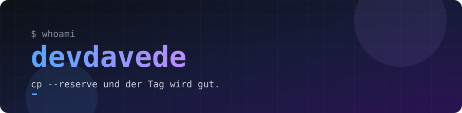

---

## 👋 Hi, ich bin David

Entwickler aus **Wien**. Ich baue gern Dinge, die zwischen Software, Netzwerk und Hardware liegen: vom Reverse Proxy in C++ über macOS-Tools bis zu 3D-gedruckten Adaptern.

- 🔭 Aktuell: **atomwall**, ein selbst gehosteter Reverse Proxy mit TLS-Terminierung und Request-Inspektion
- 🛠️ Alltag: Claude-Skills, die mir Routine abnehmen
- 🖨️ Hobby: 3D-Druck (PTFE, Filament, STL)
- 🏴 *Team FCKGW-RHQQ2*

## 🧰 Tech Stack

## 🚀 Projekte

## 📊 GitHub Stats

## 🏆 Trophäen

---

<code>cp --reserve</code> und der Tag wird gut. 🤘

